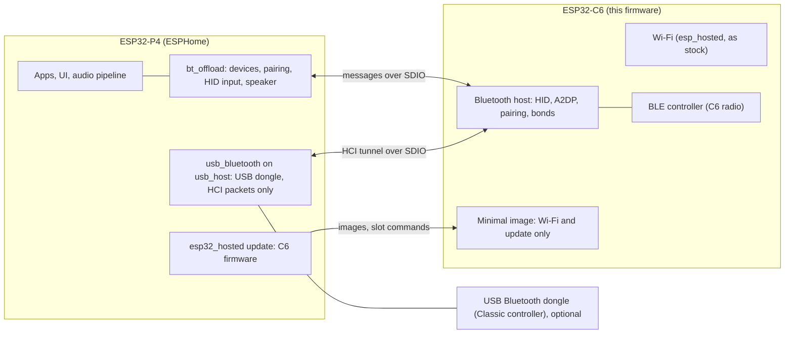

# Custom C6 networking with extended Bluetooth

Firmware for the ESP32-C6 coprocessor of ESP32-P4 boards. It does what the stock
[esp_hosted](https://github.com/espressif/esp-hosted-mcu) coprocessor firmware does for Wi-Fi, and it runs the
Bluetooth host on the C6 instead of on the P4. The P4 receives finished results: HID reports, pairing events, a
speaker it can send audio to.

It makes sense in both cases: with the C6 alone, and more with a USB Bluetooth dongle, because the dongle also does
Bluetooth Classic and the C6 firmware then takes over more.

| | Stock esp_hosted firmware | This firmware, C6 alone | This firmware with a USB Bluetooth dongle |
|---|---|---|---|
| Wi-Fi for the P4 | yes | yes, unchanged | yes, unchanged |
| BLE devices (HID, sensors' advertisements) | radio on the C6, host stack on the P4 | radio and host stack on the C6 | radio and host stack on the C6 |
| Bluetooth Classic (most keyboards, gamepads, speakers) | no | no | yes: the dongle is the Classic radio, the host stack on the C6 drives it |
| Bluetooth audio to a speaker or receiver (A2DP) | no | no | yes |
| Bluetooth work on the P4 | the complete host stack | a small message tunnel | a small message tunnel |
| Coprocessor update | over the air, two equal slots | over the air through a small second image, serial as fallback | the same |

The dongle side is our own work as well, not a part of upstream ESPHome:

| Component | What it is | Repository |
|---|---|---|
| `usb_bluetooth` | USB Bluetooth dongles as HCI controllers, with the firmware download some dongles need | [esphome-usb-drivers](https://github.com/p1ngb4ck/esphome-usb-drivers) |
| `usb_host` (reworked) | The USB host `usb_bluetooth` runs on: devices are handed to the drivers by their class, both USB controllers of the ESP32-P4 at once, dongles that start in the wrong mode are switched automatically | [esphome-usb-host](https://github.com/p1ngb4ck/esphome-usb-host) |

With this firmware `usb_bluetooth` passes the dongle's packets on to the C6; the Bluetooth host for both radios is
the one on the C6.

> [!WARNING]
> Experimental. See [Honest assessment](#honest-assessment) before you put it on a device you depend on.

## Goals

- **Nothing of Bluetooth on the P4's main loop.** Scanning, pairing, reconnects and audio encoding happen on the C6.
- **Bluetooth Classic and BLE together on the ESP32-P4** when a dongle is plugged in. The P4 has no radio and the C6
  has no Classic radio. One Bluetooth host on the C6 drives two controllers: the C6 radio for BLE and the dongle for
  Classic.
- **Every kind of HID device plus one audio device at the same time**: BLE and Classic keyboards, mice, remotes and
  gamepads, and one Bluetooth speaker or receiver.
- **Updates a user can run without tools**: over the air, with a way back when an update fails, and a way from the
  stock firmware to this one and back.

## Why

On a P4 board the usual setup runs the Bluetooth host stack on the P4 and uses the C6 only as a BLE radio. That
costs the P4 what it has least of: internal RAM and uninterrupted time. Connecting, pairing and reconnecting
Bluetooth devices produced short stalls in video playback, emulation and audio on the P4, and Bluetooth links
dropped when the P4 was busy. This is so with BLE alone already. Bluetooth Classic was only possible by running a
second controller (the USB dongle) under the same host stack on the P4, which made both problems larger.

Moving the host stack to the C6 turns Bluetooth into a service: the P4 sends audio samples and receives input
reports. What the C6 does while a device pairs or reconnects no longer competes with the P4's applications.

## How

- **One host, one or two controllers.** The host on the C6 talks to its own BLE controller directly. With a dongle
  it also talks to the dongle's Classic controller through a tunnel: the P4 forwards the dongle's HCI packets over
  the existing esp_hosted SDIO link without looking into them.
- **Messages instead of a stack.** Scan results, pairing requests, connected devices, HID reports and audio state
  travel as small messages on the same link. Audio goes the other way as PCM; the C6 encodes it for the speaker.
- **Bonds stay on the C6** and are mirrored to a file on the P4's storage, so they survive a full reflash of the C6.
- **Two images on the C6's 4 MB flash.** The main image takes most of it. A small second image with Wi-Fi and the
  update function only stands in while the main image is replaced, and is what the C6 falls back to when a new main
  image does not come up.

More detail: [docs/how-it-works.md](docs/how-it-works.md).

## Honest assessment

### What you gain

| | |
|---|---|
| The P4 runs no Bluetooth host stack | Its internal RAM and its main loop are free of Bluetooth; pairing and reconnects on the C6 do not stall the P4's applications |
| Bluetooth Classic on a P4 board | With a dongle: Classic keyboards, gamepads and one speaker or receiver, beside BLE devices |
| Several devices at once | Measured with two BLE HID devices, two Classic HID devices and music to a receiver at the same time, without audio stutter ([measurements](docs/measurements.md)) |
| Updates without opening the device | Over the air in about half a minute with the P4 running on; serial repair through the P4 when wired |
| A way in and a way out | From the stock firmware and back over the air |
| Wi-Fi as before | The Wi-Fi part is esp_hosted's own, with its buffers at their defaults |

### What it costs

| | |
|---|---|
| It is new | Written and tested within weeks, with a handful of Bluetooth devices. See [What it was tested with](#what-it-was-tested-with) |
| It is built on ESP-IDF 6.2 | The C6 firmware and the P4 side are developed, built and tested with ESP-IDF 6.2.0, which is not what upstream ESPHome uses by default. See [ESP-IDF 6.2](#esp-idf-62) |
| RAM on the C6 is always tight | The C6 has no PSRAM. With five devices and music about 54 KB of its RAM are free, and while devices connect it dips to a few KB. The Bluetooth host restarts the chip when an allocation fails. Every feature added here has to be paid for in RAM somewhere else |
| A C6 restart is not transparent | When the C6 restarts under the running P4, the P4 reboots or loses the link until a power cycle |
| It patches ESP-IDF and esp_hosted | Thirteen patches to the Bluetooth host and to esp_hosted are applied at build time, against one ESP-IDF commit and esp_hosted 3.1.0. A new version of either needs the patches checked |
| It needs ESPHome components that are not in upstream ESPHome | `bt_offload`, `usb_bluetooth`, the reworked `usb_host` and the extended `esp32_hosted` update are our own work and come from our repositories |
| One audio device, A2DP only | One speaker or receiver at a time, SBC, no hands-free profile yet |
| The switch rewrites the partition table | One short step of the switch between the firmwares cannot be undone over the air if power fails in it |
| 4 MB of C6 flash required | The two images do not fit less |

It works on the development device without known open faults at the time of writing. It is still to be considered
experimental.

### What it was tested with

| | Tested | What to expect elsewhere |
|---|---|---|
| Boards | Waveshare ESP32-P4-Module-DEV-KIT (rev 3.2) with this firmware; the Bluetooth work it grew out of also on the older Waveshare ESP32-P4-WIFI6-DEV-KIT (rev 1.3) | ESP32-P4 boards with a C6 for Wi-Fi are built in almost the same way. We expect faults to be of a general kind, not tied to one board or revision |
| USB Bluetooth dongles | A Realtek RTL8851BU dongle with this firmware. Before this firmware, with the Bluetooth host still on the P4, also a very old Bluetooth 2.0 dongle that needs no firmware download (it worked, with the short radio range of its age) | The tunnel passes the dongle's HCI packets on and does not care which dongle they come from. What differs per dongle is the firmware download in `usb_bluetooth` |
| Bluetooth devices | A BLE mouse, a BLE remote control, a Classic keyboard, a Classic gamepad and an AV receiver as audio sink | Other devices are untested |

### ESP-IDF 6.2

Everything here is built on ESP-IDF 6.2.0: the C6 firmware, and the ESPHome firmware on the P4 it was developed and
tested with. Upstream ESPHome builds with ESP-IDF 5.5 by default, so this has to be set on purpose.

| | How | Why |
|---|---|---|
| C6 firmware | The build script uses the ESP-IDF 6.2.0 copy ESPHome installs ([docs/building.md](docs/building.md#requirements)) | The patches change ESP-IDF's own Bluetooth host sources. They are written against this version and stop the build when a place they change looks different |
| P4 firmware | A `framework` block in the ESPHome configuration ([docs/esphome-config.md](docs/esphome-config.md#framework)) | It is the version all of our ESPHome work is built and run on. The components of this work have not been run on ESPHome's default version |

ESP-IDF 6.2.0 has no release tag yet; it is the `master` branch of ESP-IDF.

## What you need

| Part | Notes |
|---|---|
| ESP32-P4 board with an ESP32-C6 coprocessor on SDIO | C6 flash of 4 MB or more |
| ESPHome with our components, built on ESP-IDF 6.2.0 | `esp32_hosted` with its extended `update` platform, `bt_offload`, [`usb_bluetooth`](https://github.com/p1ngb4ck/esphome-usb-drivers) on the reworked [`usb_host`](https://github.com/p1ngb4ck/esphome-usb-host) (see [docs/esphome-config.md](docs/esphome-config.md)) |
| USB Bluetooth dongle on the P4's USB host port | optional: adds Bluetooth Classic and audio; BLE works without it |
| A storage on the P4 (SD card, USB stick) or a web server | holds the firmware images for the update |
| Optional: access to the C6's UART0 and IO9 | serial flashing, the fallback when an update over the air fails. Depending on the board these are header pins, a JST connector or pads to solder ([docs/flashing.md](docs/flashing.md#reaching-the-c6s-uart)). Wired to three GPIOs of the P4, the P4 flashes the C6 itself; with a USB-UART adapter it works without our firmware on the P4 |

## Documentation

| Page | Content |
|---|---|
| [docs/getting-started.md](docs/getting-started.md) | From a board with the stock firmware to a paired Bluetooth device |
| [docs/esphome-config.md](docs/esphome-config.md) | The ESPHome configuration on the P4, every option |
| [docs/building.md](docs/building.md) | Compiling the firmware, the files a build produces |
| [docs/flashing.md](docs/flashing.md) | Every way to get the firmware onto the C6: over the air, serial through the P4, USB adapter; switching from the stock firmware and back |
| [docs/how-it-works.md](docs/how-it-works.md) | Flash layout, the two images, the tunnel, what the patches change |
| [docs/measurements.md](docs/measurements.md) | Memory, update times and image sizes measured on a device |
| [docs/troubleshooting.md](docs/troubleshooting.md) | What the status values mean, what to do when an update fails |

## Repository layout

| Path | Content |
|---|---|
| `components/c6_xbt/` | The firmware's own code: Bluetooth host glue, tunnel, update and slot handling |
| `components/esp_now_hosted/` | ESP-NOW for the P4 through the C6's radio, built into both images. See its [README](components/esp_now_hosted/README.md) |
| `patches/` | Changes applied to the build's copies of ESP-IDF's Bluetooth host and of esp_hosted |
| `variants/offload.sdkconfig` | Build options of the main image |
| `scripts/build_local.sh` | The build: both images, the factory image, the update manifest |
| `esphome/` | The part that runs on the P4, for reading in one place: our components `bt_offload` and `usb_bluetooth`, ESPHome's `esp32_hosted` with our changes, and those changes as a patch against ESPHome. See [esphome/README.md](esphome/README.md) |

## License

See [LICENSE](LICENSE).
