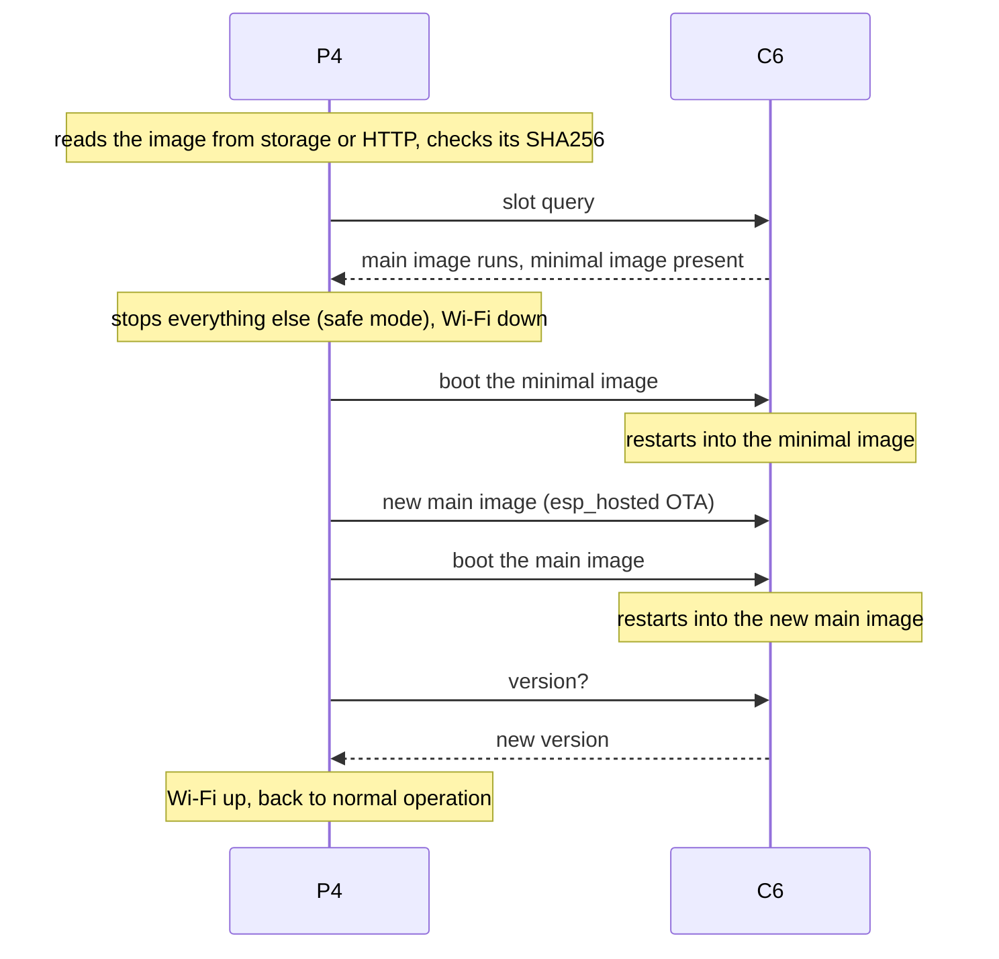
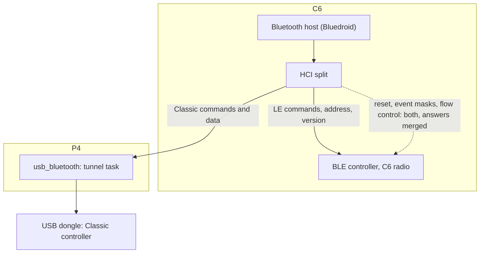

# How it works

## Flash layout

The firmware uses its own partition table on the C6's 4 MB flash. The stock esp_hosted table is shown beside it
because the switch between the two firmwares rewrites exactly this table.

| Partition | Offset | Stock size | Size here | Content with this firmware |
|---|---|---|---|---|
| `nvs` | 0x9000 | 0x4000 (16 KB) | 0x4000 (16 KB) | Settings, Bluetooth bonds |
| `otadata` | 0xD000 | 0x2000 | 0x2000 | Which app slot boots |
| `phy_init` | 0xF000 | 0x1000 | 0x1000 | Radio calibration |
| `ota_0` | 0x10000 | 0x1C0000 (1.75 MB) | 0x290000 (2.56 MB) | Main image |
| `coredump` | 0x2A0000 | - | 0x10000 (64 KB) | Crash record of the last crash |
| `ota_1` | 0x1D0000 stock, 0x2B0000 here | 0x1C0000 (1.75 MB) | 0x150000 (1.31 MB) | Minimal image |

`ota_0` starts at 0x10000 in both tables. That one shared address is what makes the switch possible: an image
there boots under either table.

## Two images

| | Main image | Minimal image |
|---|---|---|
| Wi-Fi for the P4 | yes | yes |
| Bluetooth host | yes | no |
| Accepts an image over the air | no, it refuses | yes |
| Slot commands | report state, boot the other image | the same, plus copy itself and write a partition table |
| Runs | always | during an update, or when the main image does not come up |

The stock firmware keeps two full copies of itself. This firmware with the Bluetooth host is too large for
that on 4 MB, so the second slot holds a small image that can do one thing: keep the link to the P4 up and take a
new main image.

### An update over the air

- The P4 keeps running the whole time. Only Wi-Fi and Bluetooth are away while the C6 restarts.
- Bonds and settings on the C6 stay.
- A new main image has to reach the P4 once before it counts. One that never does is dropped at the next reset and
  the minimal image boots instead. This needs this firmware's own bootloader; a C6 that came from the stock
  firmware over the air keeps the stock bootloader, which starts the last written image without this check.
- An image the C6 rejects (damaged, wrong chip) leaves the C6 in its minimal image with Wi-Fi up. The P4 reports
  the failure and, with the serial route configured and a factory image named in the manifest, repairs it over
  serial by itself.

### The minimal image has a revision

The minimal image is normally left alone by an update. When a new firmware needs a newer minimal image, its
manifest carries a higher `minimal_revision`. The P4 then renews the minimal image first, with the same steps in
a longer chain: the old minimal image takes the new one into the main slot, the new one copies itself into the
minimal slot, and the main image follows.

### Switching between the stock firmware and this one

Both directions run over the air and are started like any update: by offering the other firmware's manifest.
The steps are in [flashing.md](flashing.md#from-the-stock-firmware-and-back).

## One Bluetooth host, two controllers

The host sees one controller. A small layer under it sends every HCI command where it belongs: LE commands and
the device address to the C6's radio, Classic commands and data to the dongle, and the few commands that concern
both (reset, event masks, flow control, supported commands) to both, with their answers merged into one.
Connection handles of the LE side are renumbered so the two controllers never collide.

Without a dongle the host starts on the C6 radio alone. The P4 tells the C6 which case applies when it starts.

## The link to the P4

Everything travels over the SDIO link esp_hosted already uses for Wi-Fi.

| Direction | Content |
|---|---|
| C6 to P4 | HCI packets for the dongle, HID reports and report descriptors, found devices, pairing requests and results, audio state and window, status values, log lines when asked for |
| P4 to C6 | HCI packets from the dongle, commands (scan, connect, forget, reply to a pairing request), audio as PCM, volume |

- Both directions are flow controlled with running totals, so a lost frame never shrinks the window for good.
- Audio is 16 bit stereo PCM at 44100 Hz. The C6 buffers 16 KB of it (about 93 ms) and encodes it for the speaker.
- Nothing on the C6 allocates memory per packet on this path: frames are written into fixed rings and handed to
  esp_hosted where they lie.

## The P4 side

| Component | Job | Branch in [p1ngb4ck/esphome](https://github.com/p1ngb4ck/esphome) |
|---|---|---|
| `esp32_hosted` update platform | Update over the air through the minimal image, serial flashing, switch from and to the stock firmware, minimal renewal | `pr/esp32-hosted-update-sources` |
| `usb_bluetooth` with `c6_offload` | The tunnel between the dongle and the C6 | `pr/usb-bluetooth` |
| `bt_offload` | Devices, pairing, HID input, speaker, status, bond backup | `pr/bt-offload` |

A copy of these three components and the changes to `esp32_hosted` as a patch against ESPHome are in this
repository: [esphome/](../esphome/README.md).

The P4 mirrors the C6's bonds into a file on its storage (`/sdcard/bluetooth/c6_bonds.bin`) and writes them back
after a serial flash, which erases the C6's settings.

## What the build changes in ESP-IDF and esp_hosted

The build patches its own copies; the installed ESP-IDF stays as it is.

| Patch | What it changes | Why |
|---|---|---|
| `idf_bt_controller_route.py` | The host's HCI driver hooks | Two controllers under one host |
| `idf_bt_fixed_queue_atomic.py` | A queue hand-over in the host becomes one step | On the single-core C6 a half-done hand-over could spin the HCI task until the watchdog reset the chip |
| `idf_bt_simple_pairing.py` | Outgoing Classic pairing asks for plain pairing with bonding | Old receivers and keyboards refuse a pairing that asks for a number comparison |
| `idf_bt_a2dp_mtu_buffer.py` | Audio packets sized to the link's packet size | Less memory per queued packet |
| `idf_bt_gattc_keep_cache.py` | A BLE device's service list stays in memory after it disconnects | Faster reconnects without a new discovery |
| `idf_bt_gattc_notify_copy.py` | A BLE notification is copied with its real length | Less memory per HID report |
| `idf_bt_l2c_ertm_queues.py` | Three queues per L2CAP channel are created at first use | About 1 KB less per open channel |
| `idf_hidh_no_classic.py` | The HID host helper leaves Classic HID to the firmware's own code | One Classic HID host only |
| `idf_bt_strlcpy.py` | A string copy | Build with ESP-IDF 6.2 |
| `hosted_fw_build.py` | The build number in the version the C6 reports | The P4 can tell builds apart |
| `hosted_ota_guard.py` | The main image refuses an esp_hosted OTA | The stock handler would erase the minimal image |
| `hosted_task_stacks.py` | Stack sizes of esp_hosted's tasks | Measured use on this firmware |
| in `build_local.sh` | SDIO packets of 2048 bytes, four receive buffers, buffers of three packets | Pairing data in one frame, bursts from the P4 |

## Safety nets

| Case | What happens |
|---|---|
| A new main image never reaches the P4 | Dropped at the next reset, the minimal image boots (with this firmware's bootloader) |
| The C6 crashes three times in a row | It starts without the Bluetooth host; Wi-Fi and updates keep working |
| The C6 crashed | The next start reports the crashed task and addresses in the P4's log |
| An update over the air fails | The minimal image keeps Wi-Fi up; serial repair when configured |
| Power is cut while the partition table is rewritten | The one step that cannot be undone over the air. It is a single 4 KB sector write. Recovery is a serial flash |
